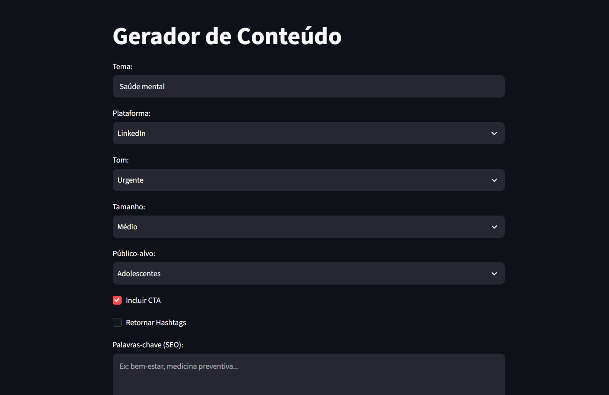
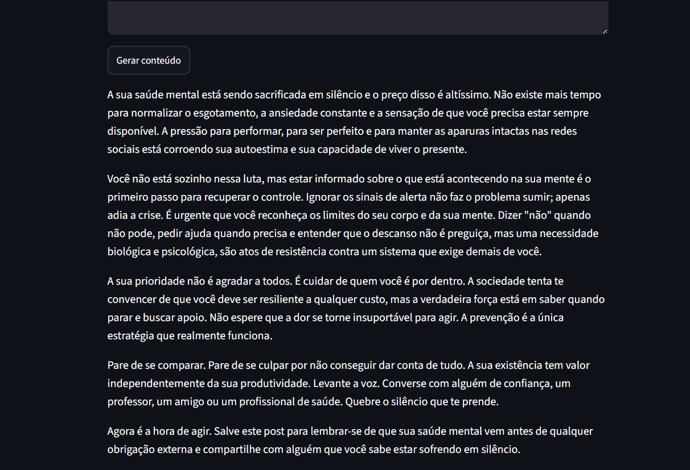

# 🤖 Agentes de IA para Empresas e Negócios

Repositório de agentes de IA aplicados a diferentes áreas de negócio:

| Área | Objetivo |
|---|---|
| 📣 Marketing | Assistente para geração de conteúdo, adaptando textos a diferentes públicos, canais e objetivos de forma escalável. |
| 👥 Recursos Humanos | Classificação de currículos com IA, com saída estruturada em JSON contendo score, aderência à vaga e sugestões de perguntas para entrevista. |
| 🎧 Atendimento/Suporte | Assistente inteligente de atendimento com RAG sobre documentos internos do Safe Bank, automatizando o suporte e respondendo rápido pelo chat. |

---

## 📣 1. Agente de Marketing: **Gerador de Conteúdo**

Um assistente que gera conteúdo otimizado para SEO, adaptado ao **canal de divulgação** e ao **público-alvo**, por meio de uma interface simples com campos personalizáveis:

- Plataforma (Instagram, Facebook, LinkedIn, Blog, E-mail)
- Tom da mensagem, tamanho do texto e público-alvo
- Tema e palavras-chave (SEO)
- Opções extras: incluir chamada para ação (CTA) e hashtags

O [projeto](./Marketing/app.py) foi construído a partir de um estudo de caso de uma clínica de saúde, mas pode ser adaptado para qualquer área de negócio.

### Interface

<p align="center">
    
</p>
<p align="center">
    
</p>


### Tecnologias

- **Python**
- **LangChain**: construção da chain (prompt template + LLM + output parser)
- **Groq**: inferência da LLM
- **Streamlit**: interface web

### Como Executar

```bash
pip install -r requirements.txt

cd Marketing
```

Crie um arquivo `.env` na pasta do agente com a sua chave (veja o `.env.example`):

```
GROQ_API_KEY=sua_chave_aqui
```

```bash
streamlit run app.py
```

## 🎧 2. Agente de Atendimento/Suporte: **Assistente Virtual Safe Bank**

Um chatbot de atendimento que responde dúvidas dos clientes com base em **documentos internos** do Safe Bank (PDFs), usando **RAG** (*Retrieval-Augmented Generation*). Em vez de depender só do conhecimento da LLM, o assistente busca os trechos mais relevantes nos documentos e os usa como contexto para responder.

- Indexação automática dos PDFs da pasta `docs/`
- Respostas fundamentadas no conteúdo dos documentos, de forma concisa e em português
- Memória da conversa: perguntas de acompanhamento são reformuladas com o histórico do chat para melhorar a busca
- Interface de chat simples e rápida

O [projeto](./Suporte%20e%20Atendimento/app.py) automatiza o suporte, reduz a sobrecarga da equipe e oferece respostas rápidas pelo chat.

### Interface

<p align="center">
    
</p>


### Tecnologias

- **Python**
- **LangChain**: chain de RAG com recuperador sensível ao histórico (*history-aware retriever*)
- **Groq**: inferência da LLM
- **Streamlit**: interface de chat
- **FAISS**: banco vetorial para busca por similaridade
- **Hugging Face Embeddings** (`BAAI/bge-m3`): vetorização dos textos
- **PyMuPDF**: extração de texto dos PDFs

### Como Executar

```bash
pip install -r requirements.txt

cd "Suporte e Atendimento"
```

Coloque os PDFs que servirão de base de conhecimento na pasta `docs/` e crie um arquivo `.env` com a sua chave (veja o `.env.example`):

```
GROQ_API_KEY=sua_chave_aqui
```

```bash
streamlit run app02.py
```

> Na primeira execução, o modelo de embeddings é baixado (cerca de 2 GB) e os PDFs são indexados, então a primeira resposta pode demorar. O índice é salvo na pasta `index_faiss/`.